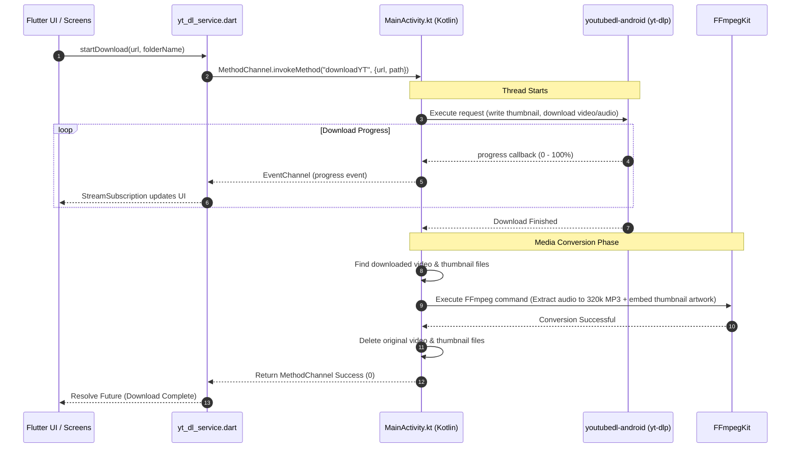

# Developer Notes & Project Architecture (localyt_music)

This document provides a comprehensive overview of the `localyt_music` project to help future developers (and LLMs) quickly understand the architecture, codebase, and current implementation status.

---

## 1. Project Overview

`localyt_music` is a Flutter-based mobile application designed to download YouTube playlists onto Android devices and play them locally offline. 

- **Target Platform**: Android (due to reliance on Android-native tools like `youtubedl-android` and FFmpeg).
- **Core Technology**: Flutter (Dart) for the UI and state management, integrated via `MethodChannel` and `EventChannel` to Kotlin (Android Native) for heavy downloading and media processing.

---

## 2. System Architecture & Data Flow

The project is split into two major layers: the **Flutter UI/Service Layer** and the **Android Native Processing Layer**.



---

## 3. Directory Structure & File Descriptions

Here are the key directories and files in this project:

```
E:\localyt-music\
├── android/                      # Native Android code
│   └── app/src/main/kotlin/.../
│       └── MainActivity.kt       # Native wrapper for yt-dlp & FFmpeg
├── lib/                          # Flutter Dart code
│   ├── main.dart                 # Application Entrypoint
│   ├── screens/                  # Application UI Screens
│   │   ├── main_screen.dart      # Navigation container (Tabs)
│   │   ├── home_screen.dart      # Placeholder for Home Dashboard
│   │   ├── playlists_screen.dart # Displays list of downloaded playlists
│   │   ├── playlist_screen.dart  # Displays songs inside a specific playlist (Placeholder)
│   │   ├── add_playlist_screen.dart # Form to add/download new playlists (Placeholder)
│   │   ├── setting_screen.dart   # Placeholder for App settings
│   │   └── test_download_screen.dart # Test UI for validating yt-dlp downloading
│   └── services/                 # Local service layer
│       ├── file_service.dart     # Manages local folders and shared preferences
│       └── yt_dl_service.dart    # Method/EventChannel wrapper for Native downloader
└── pubspec.yaml                  # Flutter package configuration
```

### Key Files Linkage
- [main.dart](file:///E:/localyt-music/lib/main.dart)
- [main_screen.dart](file:///E:/localyt-music/lib/screens/main_screen.dart)
- [MainActivity.kt](file:///E:/localyt-music/android/app/src/main/kotlin/com/example/localyt_music/MainActivity.kt)
- [yt_dl_service.dart](file:///E:/localyt-music/lib/services/yt_dl_service.dart)
- [file_service.dart](file:///E:/localyt-music/lib/services/file_service.dart)

---

## 4. Native Implementation Details (`MainActivity.kt`)

### 1) yt-dlp Configuration
The application leverages the `youtubedl-android` wrapper. The downloader options used in [MainActivity.kt](file:///E:/localyt-music/android/app/src/main/kotlin/com/example/localyt_music/MainActivity.kt) are:
- `--yes-playlist`: Ensures full playlists are processed.
- `--extractor-args "youtube:player_client=android"`: Bypasses certain bot detection rules by pretending to be an Android player client.
- `--download-archive downloaded.txt`: Avoids re-downloading previously processed tracks (increments/syncs existing playlists).
- `--write-thumbnail`: Obtains the thumbnail/artwork.

### 2) FFmpeg Conversion & Artwork Metadata Embedding
Once download completes, the code iterates over all files in the playlist subdirectory (excluding `.txt`, `.mp3`, and images). It maps the video file and its thumbnail, then executes the following FFmpeg command:
```bash
-i "<video_file>" -i "<thumbnail_file>" -vn -ab 320k -y -map 0:a -map 1:v -c:v mjpeg -disposition:v attached_pic "<output_mp3_file>"
```
- `-vn`: Disable video stream processing in primary output.
- `-ab 320k`: Set audio bitrate to 320kbps.
- `-map 0:a`: Map audio from the first input (video).
- `-map 1:v`: Map video (image) from the second input (thumbnail).
- `-c:v mjpeg -disposition:v attached_pic`: Write the image as standard MJPEG ID3v2 attached picture (album art).

Upon successful conversion, both the original video and thumbnail files are deleted to conserve space.

---

## 5. Current Implementation Status & Pending Tasks

| Feature | Component | Status | Details / Next Steps |
| :--- | :--- | :---: | :--- |
| **Native Downloading Engine** | Android Kotlin (`MainActivity.kt`) | **Completed** | fully wraps `youtubedl-android` and `ffmpeg-kit`. Includes update mechanism. |
| **Download Test UI** | `test_download_screen.dart` | **Completed** | Working UI for testing downloads with dynamic progress reporting. |
| **App Layout Skeleton** | `main_screen.dart` | **Completed** | Main structural tabs configuration (Home, Playlists, Settings). |
| **Local Playlist Listing** | `playlists_screen.dart` | **Partially Done** | Scans local Download folder and displays playlist names. Needs pull-to-refresh. |
| **Playlist Details View** | `playlist_screen.dart` | **Placeholder** | Needs to list `.mp3` files in the folder and trigger playback. |
| **Add Playlist Flow** | `add_playlist_screen.dart` | **Completed** | Full UI with inputs, validation, WillPopScope, download progress, and metadata storage. |
| **Music Playback Engine** | Flutter Services / Audio Package | **Not Started** | Needs an audio player package (e.g., `just_audio` or `audioplayers`) to stream and play local files. |
| **Permissions Handling** | Android Manifest / Runtime | **Needs Review** | Requires storage permission management (`PermissionHandler` in Dart or native requests) on Android 13+. |

---

## 6. Release Build

- **applicationId / namespace**: `com.kuroinusan.localyt_music` (Kotlinパッケージも同名)。
- **署名**: `android/key.properties` (git管理外) がkeystoreを指す。keystore本体は `C:/Users/shinj/keystores/localyt_music_upload.jks`。**このファイルとパスワードを失うと同じ署名で更新できなくなるため必ずバックアップすること。** `key.properties` が無い環境ではdebug署名にフォールバックする。
- **ProGuard/R8**: `android/app/proguard-rules.pro` 必須。特に `org.apache.commons.compress` のkeepが無いと、yt-dlp初期化(ZipUtils.unzip)で `is not a concrete class` の起動時クラッシュが発生する (releaseビルドのみ)。
- **ビルド**: `flutter build apk --release` → `build/app/outputs/flutter-apk/app-release.apk` (約130MB、ffmpeg/pythonネイティブライブラリ込み)。
- **権限**: 通知(Android 13+)とストレージ(Android 12以下)の実行時権限は `MainActivity.onCreate` で要求。

## 7. Guidelines for Future LLM Developers

When you are asked to write code for this project, keep the following rules in mind:

1. **Storage Path Constraints**: The downloads are written to the public downloads folder: `/storage/emulated/0/Download/localyt_music/{playlist_name}`. Be mindful of Scoped Storage on Android. Read/Write permissions might need specific configurations in `AndroidManifest.xml`.
2. **Audio Playback Package**: Choose a reliable playback engine. `just_audio` is highly recommended for Flutter because of its extensive feature set (playlist handling, background audio support, caching).
3. **Incremental Syncing**: Since we configure `--download-archive downloaded.txt` in the native layer, calling `startDownload` on an already downloaded playlist will only download new tracks. Utilize this feature to let users "sync" their playlists.
4. **State Management**: As the application grows, implement a clean state management approach (such as `Provider`, `Riverpod`, or simple `ValueNotifier`s) to coordinate download status, playlist syncs, and the global audio playback state.
